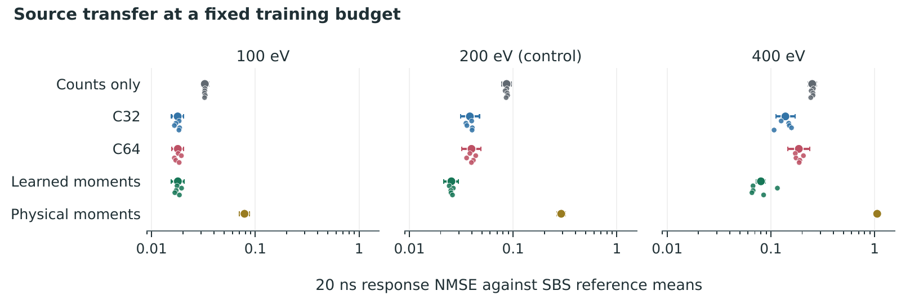

# Predicting Pulse Responses in Water Radiolysis with Compact World Models

**Humza Nusrat and Omar Nusrat** · [Citation](CITATION.cff)

A radiation track leaves a cloud of reactive molecules in water. Molecules arriving in a later pulse can react with the first cloud. We trained models at 200 eV to predict how the addition changes the counts of seven chemical species. One model kept the center and spread of each species. C64 learned to pool geometry across species. Their recurrent states occupied almost the same memory, 600 and 608 bytes per branch.

When the source energy doubled to 400 eV, the learned-moment model had **56.9% lower normalized mean squared error (NMSE)** in the pulse response than C64. All five learned-moment fits outperformed all five C64 fits. At 100 eV, their errors were similar.

## Reproduce the primary result

From the repository root, run the following in a terminal with Python 3.12. The statistical replay uses NumPy on CPU. All inputs for this transfer evaluation are in the repository.

```sh
python3.12 -m venv .venv
source .venv/bin/activate
python -m pip install -r requirements.txt
python reproduce.py
```

On Windows, create the environment with `py -3.12 -m venv .venv` and activate it in PowerShell with `.\.venv\Scripts\Activate.ps1`. Once NumPy is installed, the replay runs offline. To save full-precision results for every fit, run `python reproduce.py --json > results.json`.

| Source energy | Learned moments | C32 | C64 |
| --- | ---: | ---: | ---: |
| 100 eV | 0.0179 | 0.0178 | 0.0179 |
| 400 eV | 0.0801 | 0.1379 | 0.1858 |

Entries give normalized mean squared error (NMSE) in the 20 ns pulse response, averaged over the five fits. The **prespecified comparison** gives the two energies equal weight. Learned moments minus C64 is **−0.0528 NMSE** (paired 95% interval **−0.0790 to −0.0326**). A negative difference favors learned moments. The secondary contrast against C32 is −0.0288 (unadjusted 95% interval −0.0453 to −0.0159).



*Figure 2 from the manuscript. Small points show individual fits, large points show means, and bars are 95% intervals over source families. The middle panel shows fresh families at the training energy.*

## What the replay calculates

1. For each held-out cloud and pulse condition, average 64 Geant4-DNA step-by-step simulations on each branch. Subtract the passive count from the pulse count to obtain the reference response for each of seven species at 20 ns.
2. For each fitted model, calculate the same difference from its two forecasts. Divide the discrepancy by the species’ root-mean-square passive training count, with a floor of one molecule, then square it. Average the losses across species, the five fixed fits, and the four pulse conditions for each source family.
3. Pair the models within each family. Resample whole families 4,000 times within each energy, with 64 families at 100 eV and 64 at 400 eV. Average the two energy estimates with equal weight. The interval measures variation across sources for these fitted models.

The default command starts with 65,536 simulated branch endpoints and the saved forecasts. It recomputes every family loss, every fit’s transfer error and both intervals, and checks them against the archived analysis. Input files have SHA-256 checksums. [Endpoint data and field definitions](primary/data/README.md) · [Scoring code](primary/score_endpoints.py) · [Bootstrap code and archived estimates](primary/reference)

## Regenerate the model forecasts

The optional CPU inference replay starts one step earlier, with the initial and incoming molecular coordinates and all 15 fitted checkpoints. It reruns both branches of each case and checks the seven species counts against the endpoints used above. A short check and the full 512-case evaluation are documented together. [Inference instructions, cases and weights](inference/README.md)

## Explore the other results

The supporting analyses reproduce the comparison between active and passive training, the pulse-schedule tests, the conditional forecasting cost and the mean-yield estimates. The figure scripts redraw the four main figures and the appendix training curves. [Supporting commands](supporting/README.md) · [Per-species 400 eV errors in molecules](supporting/headline_replay/species_response_400eV.csv)

At 400 eV, replacing pair-specific encounter volumes with one cloud-wide scale raised the moment model's NMSE from 0.0801 to 0.1344. All five original moment fits also beat every shared-scale fit on the three-pulse schedules. Narrowing C64 at fixed weight decay lowered its 400 eV NMSE from 0.1966 to 0.1623 and left its three-pulse error close to the full-width value. With the same simulation budget, fitting moments only to undisturbed trajectories raised 400 eV pulse-response error sixfold. These exploratory comparisons use five fixed seeds per method on the original training families.

## Reproduce the study from archived measurements

The [versioned research release](https://github.com/hnusrat1/water-radiolysis-world-models/releases/tag/v1.0.0) includes the native reference counts, the fitted forecasts and the programs that produced the reported comparisons. Choose the download that corresponds to the result you want to check.

| Research question | Download and run from the extracted folder |
| --- | --- |
| Which measurements support the source-transfer, native-physics, mean-yield and CPU results? | In [the six-stage statistical replay](https://github.com/hnusrat1/water-radiolysis-world-models/releases/download/v1.0.0/water-radiolysis-statistical-replay-v13.zip), install the requirements and run `python reproduce.py --output replay-report.json`. The stages use the archived trajectories, simulation counts and timing records. |
| What explains the low-energy tie, the outlying seed and the long-horizon reversal? | In [the mechanistic diagnostics](https://github.com/hnusrat1/water-radiolysis-world-models/releases/download/v1.0.0/water-radiolysis-mechanistic-diagnostics-v1.0.0.zip), run `python paired/replay.py` and `python clock_and_seed/replay.py`. The archive also contains inputs and weights for rerunning both sets of rate traces. |
| What changes when we alter the encounter rule, network width, training targets or clock? | [The exploratory scores](https://github.com/hnusrat1/water-radiolysis-world-models/releases/download/v1.0.0/water-radiolysis-ablation-scores-v1.0.0.zip) include the frozen protocols, all fit histories, solver checks and family-level errors. The README gives NumPy commands for the family-level intervals and the matched clock comparison. |
| Which Geant4 programs generated the underlying measurements? | [The native source](https://github.com/hnusrat1/water-radiolysis-world-models/releases/download/v1.0.0/radiolysis-native-source-v1.0.0.zip) contains the five study programs, the Geant4 version used, build instructions and the original source digests. |

### Run or refit the exploratory models

The original 15 checkpoints are in the repository's `inference/` directory. The release adds five seeds for each of five exploratory controls. Download [the 25 exploratory checkpoints and CPU inference code](https://github.com/hnusrat1/water-radiolysis-world-models/releases/download/v1.0.0/ICWM_v13_exploratory_inference_safetensors.zip). From the extracted folder, `python verify.py` checks each model on a 400 eV pulse and a 200 eV three-pulse schedule. Each checkpoint is in SafeTensors format.

To trace results back to individual forecasts, use [the width and encounter controls](https://github.com/hnusrat1/water-radiolysis-world-models/releases/download/v1.0.0/ICWM_v13_ablation_forecasts_and_training.zip) or [the passive-training and clock controls](https://github.com/hnusrat1/water-radiolysis-world-models/releases/download/v1.0.0/ICWM_v13_optional_moment_forecasts_and_training.zip). Each archive includes complete trajectories, numerical checks, fit histories, family-score replay and a training entry point. To repeat training, also download [the common training and evaluation inputs](https://github.com/hnusrat1/water-radiolysis-world-models/releases/download/v1.0.0/ICWM_v13_ablation_training_and_evaluation_inputs.zip) and follow the corresponding archive's README. These inputs include the original 128 training families, 32 validation families and archived native reference counts.

## Cite this work

Humza Nusrat and Omar Nusrat. *Predicting Pulse Responses in Water Radiolysis with Compact World Models*. Manuscript, 2026. [Machine-readable citation and affiliations](CITATION.cff) · [Third-party notices](inference/THIRD_PARTY_NOTICES.txt)
